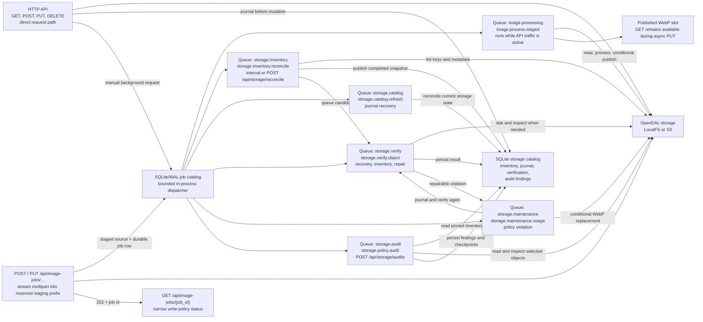
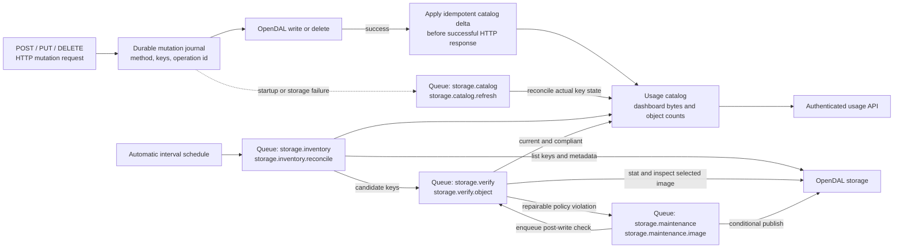

# Background Jobs

This guide describes the durable, internal job scheduler currently used by
Image Service. It is intended for contributors and operators who need to know
what work can run in the background, what starts it, and how it behaves during
traffic, errors, and shutdown.

## Current scope

The scheduler is a generic crate (`crates/job-scheduler`) with a SQLite/WAL
catalog and an in-process dispatcher. The catalog is the source of truth; the
dispatcher claims only a bounded number of rows and stores state transitions,
progress, results, errors, and events in SQLite. It is a single-Core-instance
design: do not share the SQLite database between service replicas or put its
WAL files on NFS/SMB.

The scheduler runs internal system jobs and one narrow user-facing job type:
asynchronous image processing. It has no public generic job API, no endpoint
for listing or cancelling arbitrary jobs, and no remote worker execution. The
`worker-protocol` feature contains DTOs only. Existing `/api/images/...`
routes remain synchronous; the explicit `/api/image-jobs/...` routes stage an
upload and return a durable job ID. A narrow status endpoint exposes only
those image-processing jobs.

`image.processing` is registered whenever image support is compiled. When
`IMAGE_STORAGE_USAGE_ENABLED=true`, five additional queue names are registered:
`storage.catalog`, `storage.inventory`, `storage.verify`,
`storage.maintenance`, and `storage.audit`. All queues share the scheduler's
persistent jobs database and bounded dispatcher; queues are logical partitions,
not separate processes or dedicated threads.

## Queue map

### Queues registered in this build

| Queue | Example job kind | Who creates work | Purpose |
| --- | --- | --- | --- |
| `image.processing` | `image.process.staged` | POST/PUT to `/api/image-jobs/{namespace}/{resource_id}/{slot}`, subject to `IMAGE_WRITE_AUTH` (required by default) | Priority `50`. Reads a durable staged source, applies the captured processing profile, conditionally publishes to the target slot, updates the usage journal when enabled, and removes staging after a terminal job result. This queue may run during foreground traffic, bounded by scheduler concurrency, upload memory admission, and the image-processing semaphore. |
| `storage.catalog` | `storage.catalog.refresh` | Pending journal recovery on startup or after a storage error | Priority `10`. Re-stat current object/resource state and reconcile catalog entries idempotently. |
| `storage.inventory` | `storage.inventory.reconcile` | Persisted hourly interval schedule, or authenticated `POST /api/storage/reconcile` | List canonical image-slot objects and publish a complete metadata snapshot; queue verification candidates. Scheduled priority is `-10`; manual priority is `20`. |
| `storage.verify` | `storage.verify.object` | Catalog recovery, completed inventory, or a maintenance write | Priority `-30`. Skip decoding when size, ETag, and effective policy fingerprint match a prior verification; inspect changed/new images and queue repairable violations. Successful API uploads are recorded as compliant directly from the processor result. |
| `storage.maintenance` | `storage.maintenance.image` | Verification finds a repairable policy violation | Priority `-40`. Reprocess one captured version under bounded resource limits and conditionally publish only if the object has not changed. Successful writes are journaled and verified again. |
| `storage.audit` | `storage.policy.audit` | API-key protected `POST /api/storage/audits` | Inspect a pinned inventory against the captured policy snapshot and persist findings. This explicit report remains read-only. Priority is `-20`. |

All registered queues feed the same scheduler. `IMAGE_BACKGROUND_JOB_CONCURRENCY`
limits the number of jobs claimed at once, regardless of queue. The scheduler
selects eligible work by higher priority, then age. Image processing may run while
requests are active; catalog, inventory, verification, maintenance, and audit
work wait for the configured idle period. All jobs obey service readiness,
the optional UTC window, and lease rules. Maintenance has lower priority than
verification, and both yield to foreground HTTP traffic. The initial inventory schedule is due
immediately on a new database; later automatic runs use
`IMAGE_STORAGE_INVENTORY_INTERVAL_SECONDS`. The manual reconciliation route
and the audit creation route enqueue durable jobs; callers do not run the
worker or manually resume an interrupted job.

### Asynchronous image upload pipeline

`POST` and `PUT /api/image-jobs/{namespace}/{resource_id}/{slot}` are an
explicit alternative to the synchronous image routes. The handler validates
the target and current slot rules, streams the multipart image into the
configured OpenDAL backend under the service-reserved `__image_jobs/` prefix, then
atomically records a durable `image.process.staged` job in SQLite/WAL. The
client receives `202 Accepted` only after both the staged object and job row
exist. If job admission fails, the staged object is removed.

The source body is streamed to storage instead of retained as one in-memory
buffer while receiving. Processing later reads the staged source under the
normal upload-memory admission and CPU-processing semaphore, applies the
captured namespace policy, and publishes the WebP result. The job worker is
allowed to claim this one user-facing queue while HTTP requests are active;
its concurrency remains bounded by the shared scheduler limit and image
processing admission. It still observes service readiness, lease and UTC
window rules. Inventory, verification, audit, and maintenance jobs continue
to wait for the configured quiet period.

The staging object and job database must both be on persistent storage for
accepted work to survive restart. Startup removes orphaned staging objects
that have no active job reference. Terminal job records are retained according
to `IMAGE_JOB_RETENTION_DAYS`; terminal staging data is deleted. The prefix
does not apply separate bucket permissions; restrict access to the configured
backend using its normal filesystem or object-storage controls.

The target is serialized by a bounded set of in-process resource locks. POST
is create-only. PUT may create or replace and supersedes an older active async
job for the same target. Synchronous POST/PUT/DELETE operations also cancel
pending work for that target, and resource DELETE cancels active jobs for that
resource; running work checks cancellation and a publish fence before writing.
An async PUT leaves the current image readable until the new result is ready.
The image handler allows five attempts, subject to the scheduler's retry and
lease rules. `GET /api/image-jobs/{job_id}` follows `IMAGE_WRITE_AUTH`
(`required` by default) and reports only image-job state and result; there is no
general job list or public cancellation endpoint. Optional `Idempotency-Key`
allows safe retries of the same method, target, and content.

### Mutation, verification, and maintenance pipeline

This pipeline is implemented when storage usage is enabled. Before a POST,
PUT, slot DELETE, or resource DELETE reaches OpenDAL, the service writes a
durable journal row containing operation ID, method, namespace, resource,
optional slot, status, and timestamps. Once storage succeeds, it reads current
metadata, updates the completed catalog snapshot and any active scan, marks the
journal applied, and returns success. POST/PUT results are known to satisfy the
effective policy because they came from the processor, so their validators and
policy fingerprint are recorded as compliant without decoding the result a
second time. A resource-level DELETE records its namespace/resource scope and
removes every indexed slot in one idempotent update.

Before the first full scan, the catalog still maintains an incremental live
snapshot for writes made through this service. Usage can therefore report
those objects immediately while returning `scan_status: "never"` and
`stale: true`; an audit still requires a completed full-inventory watermark.

OpenDAL and SQLite do not share a transaction. If the process exits between a
storage mutation and catalog update, the journal survives; startup recovery
copies pending rows into `storage.catalog`. Storage failures enqueue the same
recovery work immediately. Recovery re-stats actual storage state rather than
replaying a stale byte delta, so retries and DELETE-then-PUT sequences do not
double-count. Service mutations update dashboard totals promptly. Direct
LocalFS/S3 changes appear after the next full reconciliation.

The inventory job lists keys and metadata only, then submits candidates to
`storage.verify`. Recovery and inventory candidates compare size, ETag, and a fingerprint of the
effective global/profile policy with its last result. If they match, image
decoding is skipped. Otherwise it inspects format, animation, dimensions, and
output size and records the result in `storage_verification_state`. A policy
change alters the fingerprint, so the next inventory pass schedules inspection
under the new rules.

Repairable violations create low-priority `storage.maintenance.image` jobs.
Maintenance waits for the idle gate, reads and processes one captured version
under the existing memory and CPU limits, then conditionally replaces it: S3
backends use ETag `If-Match`; LocalFS serializes metadata comparison and write
under the resource lock. A newer image is not overwritten. The replacement is
journaled and verified again. Invalid or uninspectable objects are recorded
without automatic overwrite; a failed repair leaves the existing object in
place and the job failure in SQLite.

| Queue | Example job kind | Who creates work | Purpose |
| --- | --- | --- | --- |
| `storage.catalog` | `storage.catalog.refresh` | Startup recovery for pending journal rows or after storage errors | Reconcile actual current slot/resource state and queue verification for present objects. |
| `storage.inventory` | `storage.inventory.reconcile` | Persisted periodic schedule or authenticated manual reconcile | List storage, promote the complete metadata snapshot, then queue candidates for verification. |
| `storage.verify` | `storage.verify.object` | Catalog recovery, inventory completion, or maintenance write | Skip unchanged versions; inspect changed objects and enqueue maintenance for repairable violations. API uploads are marked compliant from the processor result. |
| `storage.maintenance` | `storage.maintenance.image` | Verification of a repairable violation | Reprocess one version, conditionally replace it, journal the write, then verify again. |

The journal records operation ID, HTTP method, namespace, resource, optional
slot, status, and timestamps. Updates reconcile actual current state rather
than replaying stale byte deltas. Resource DELETE is recorded as a scope, not
an in-memory list of every slot. Verification jobs are deduplicated by object
key, ETag, and size. Conditional maintenance protects newer uploads.

There is no separate human `review` queue in this design. Durable job status
and the post-maintenance verification job provide the review trail. The
existing synchronous upload contract remains: a new or replaced image is
available to `GET` after the request succeeds. The explicit async endpoint
returns before processing; its status resource reports when the result is
published. Background maintenance keeps the currently published image
readable until a validated replacement can be published safely. A failed
repair leaves the old object in place and records the failure for inspection.

The image-job status endpoint is not a generic job-status API. The usage API
exposes aggregate bytes and object counts, not per-object verification state
or maintenance progress. The internal scheduler queue is not exposed.

The periodic listing remains necessary to discover direct changes in LocalFS
or S3 that bypass the service journal. When no mutations or detected changes
exist, there are no per-object catalog, verification, or maintenance jobs to
run. The periodic listing still incurs backend listing requests; no portable
OpenDAL notification currently tells the service that external storage changed.

## Registered work

| Job kind | Queue | How it is created | What it does | Current state |
| --- | --- | --- | --- | --- |
| `image.process.staged` | `image.processing` | POST/PUT to `/api/image-jobs/{namespace}/{resource_id}/{slot}`, subject to `IMAGE_WRITE_AUTH` (required by default) | Processes a durable staged source with up to five attempts and publishes a WebP result; status is available from `GET /api/image-jobs/{job_id}` | Implemented |
| `storage.catalog.refresh` | `storage.catalog` | Startup recovery for pending journal rows or after storage errors | Reconciles current slot/resource state and queues verification for present images | Implemented |
| `storage.inventory.reconcile` | `storage.inventory` | Periodic schedule or `POST /api/storage/reconcile` | Lists canonical image-slot metadata in batches of 250, promotes a complete snapshot, and queues verification candidates | Implemented |
| `storage.verify.object` | `storage.verify` | Catalog recovery, inventory completion, or maintenance write | Skips unchanged versions; otherwise inspects and records policy compliance, queueing repairable violations. API uploads are marked compliant from the processor result. | Implemented |
| `storage.maintenance.image` | `storage.maintenance` | Verification finds a repairable violation | Reprocesses a captured version, conditionally replaces it, journals the write, then verifies again | Implemented |
| `storage.policy.audit` | `storage.audit` | `POST /api/storage/audits` when storage usage is enabled | Inspects a pinned inventory and policy snapshot in small batches; records findings without changing objects | Implemented |

The inventory job reads object keys and metadata. It does not decode image
bodies or repair objects. A failed or interrupted scan leaves the last
successfully completed snapshot available. See the
[storage usage API](api.md#storage-usage-reporting) for its query and response
semantics.

The policy audit is separate from automatic verification and remains read-only. It decodes image bodies to inspect WebP format,
animation, dimensions, and output size; it does not transform or write objects.
It captures the effective global and namespace profile settings at start,
checks indexed size and ETag when available, and retains the source inventory
while queued or running. Progress and findings are persisted in the storage
catalog so a retry or process restart resumes after the last object recorded.
It uses the image upload memory budget and image-processing semaphore, limits
each batch to ten objects, and waits for the foreground idle period between
batches. `GET /api/storage/audits/{audit_id}` reports progress and
`GET /api/storage/audits/{audit_id}/findings` returns paginated results.

Periodic schedule details:

- Schedule ID: `storage-inventory-periodic`.
- On a new installation, the first run is due immediately after registration.
  Its execution still waits for the dispatcher's readiness, quiet-period, and
  optional UTC-window gates. On later starts, the persisted next-run time is
  retained rather than reset to immediate.
- Later runs are due at `IMAGE_STORAGE_INVENTORY_INTERVAL_SECONDS` intervals
  (default `3600`, valid range `60..=2678400`).
- Scheduled jobs have priority `-10` and allow up to five attempts.
- If a run from this schedule is pending, running, or waiting to retry when
  the next interval becomes due, the scheduler does not create a duplicate.
  The next due time is advanced; it does not build an unbounded backlog of
  missed intervals.

Manual requests use the same handler, with priority `20` and an active-job
deduplication key. Repeated manual requests while the job is pending, running,
or retrying return the existing job ID instead of queuing duplicate scans.

## When a job can start

The dispatcher checks these gates before claiming every job:

1. The service has completed startup and is ready.
2. There are no active API requests, and the configured quiet period has
   elapsed (`IMAGE_BACKGROUND_IDLE_SECONDS`, default `30`).
3. If `IMAGE_BACKGROUND_WINDOW_UTC` is set, the current time is inside that
   UTC window.
4. A registered handler exists for the job kind, the job is due, its
   dependencies have succeeded, and a worker slot is available.

The dispatcher polls at a one-second interval. `IMAGE_BACKGROUND_JOB_CONCURRENCY`
sets the maximum number of simultaneously claimed jobs (default `1`, range
`1..=64`). This is a bound on concurrent jobs, not on the number of persisted
jobs.

Gates apply before a job is claimed; they do not preempt a running job. The
inventory handler also checkpoints every 250 indexed objects and waits for the
quiet-period condition again before processing another batch. A UTC window
closing does not stop an already running handler. Other handlers must make
their work units bounded and honor checkpoints/cancellation if they need
similar yielding behavior.

The quiet-period gate applies to system catalog and policy work. The
`image.processing` handler opts into dispatch during foreground HTTP activity,
so it can process explicitly accepted user uploads even on a busy service.
It remains bounded by the shared scheduler concurrency, upload memory budget,
and image-processing semaphore. All work still obeys readiness, handler,
dependency, lease, due-time, and optional UTC-window checks.

`IMAGE_BACKGROUND_IDLE_SECONDS=0` removes the delay since last activity for
system jobs, but the dispatcher still requires zero active API requests before
claiming those jobs. An optional UTC window is an additional condition, not a
replacement for idleness.

## Adding another system job

Contributors should register a stable handler kind and, if recurring, a stable
schedule ID before starting the dispatcher. Treat both identifiers and the
persisted payload shape as durable data: when a payload's meaning changes in
an incompatible way, introduce a versioned kind or provide an explicit data
migration. A handler should validate its payload, make external side effects
idempotent, process bounded units, checkpoint useful progress, and honor
cancellation at safe boundaries. Set a retry policy only for errors that can
reasonably succeed later, and avoid storing secrets or large blobs in SQLite.

Register handlers only when their required feature and dependencies are
available. A persisted job whose handler is not registered is not claimed; it
remains in SQLite until a compatible handler is registered again. For example,
the image inventory handler is registered only when image support and
`IMAGE_STORAGE_USAGE_ENABLED=true` are active.

## Job lifecycle and recovery

Jobs are persisted as `pending`, `running`, `retry_wait`, `succeeded`,
`failed`, or `cancelled`. Claiming a job increments its attempt count and
assigns a lease. The default lease is 60 seconds and is refreshed while the
handler runs. If the process exits or loses the lease, the job becomes
claimable after the lease expires. A handler that cannot checkpoint after
losing its lease must discard its late result.

Handlers return success or failure, and failures may be marked retryable.
Retryable failures are scheduled with exponential backoff, beginning at 1
second and capped at 1 hour, until `max_attempts` is reached. The inventory
handler allows five attempts. Exhausted or non-retryable failures become
terminal `failed` jobs. A dependent job is not claimable until all parents
succeed; it becomes cancelled if a dependency fails or is cancelled.

The scheduler API supports cancellation internally, but Image Service does
not expose a public cancellation route. Synchronous image mutations may cancel
targeted image jobs as described above. Other pending/retrying work can be
cancelled by an internal caller. For running work, cancellation is signalled
to its handler; the handler must check it and stop at a safe boundary. The
inventory handler checks between listing entries and batches, and the image
handler checks before publishing.

On SIGINT/SIGTERM, the service stops claiming jobs and drains active handlers
for up to `IMAGE_SHUTDOWN_TIMEOUT_SECONDS`. If that deadline expires, the
dispatcher is aborted; the active job's lease remains in SQLite and permits
recovery after expiry on the next startup. This is at-least-once execution:
handlers must tolerate a retry after a crash and should make side effects
idempotent or checkpoint their progress safely.

## Retention and persistence

Terminal job records and event history become eligible for pruning after
`IMAGE_JOB_RETENTION_DAYS` (default `30`, valid range `1..=3650`). The
dispatcher checks for pruning at most once per hour, while it is allowed to
claim work (ready, idle/window gates open, and at least one handler
registered). Jobs still referenced by dependent jobs are retained. Pruning is
scheduler housekeeping, not a separately queued job. Queued and active jobs
are not removed by this retention policy.

`IMAGE_JOB_DB_PATH` selects the durable job database. Keep its database,
`-wal`, and `-shm` files on persistent local storage. Storage inventory has a
separate catalog database selected by `IMAGE_STORAGE_CATALOG_DB_PATH`; both
paths should be covered by the same persistent container volume when using
the default Docker layout. A temporary filesystem intentionally loses queued
work and inventory state when the container is removed.

## Current limits and future work

- Jobs are dispatched in-process by one service instance; there is no external
  worker transport or cross-instance coordination.
- Persisted jobs whose handler is not registered remain unclaimed; disabling a
  feature does not delete their rows.
- There is no public generic job listing or cancellation API. Only image-job
  details are exposed through `GET /api/image-jobs/{job_id}`.
- The periodic inventory still lists all canonical image slots. Verification
  jobs are cheap when metadata and policy match, but the scheduler currently
  does not compare the listing to its prior snapshot before enqueueing them.
- Automatic repair applies only to canonical image slots and the image
  processor's current WebP policy. It does not cover other processor types.
- There is no per-queue concurrency or time-window configuration; priorities
  share the scheduler-wide concurrency limit and idle/window gates.
- Aggregate usage is public through authenticated API endpoints, but journal,
  verification, and maintenance job detail is internal and not exposed to a
  dashboard.

These boundaries are intentional for the current release. New system jobs
should document their trigger, queue, idempotency, checkpoints, retry policy,
load impact, and shutdown behavior before registration.

## Code map

- `crates/job-scheduler/src/lib.rs`: SQLite schema, job and schedule APIs,
  leases, retries, dispatcher gates, cancellation, and runtime shutdown.
- `crates/file-core/src/lib.rs`: scheduler initialization, handler
  registration, startup, and graceful drain.
- `crates/file-core/src/state.rs`: scheduler configuration and shared
  activity/readiness state.
- `crates/file-core/src/storage_usage.rs`: inventory and audit handlers,
  authenticated API triggers, checkpoints, findings, and catalog persistence.
- [Configuration](configuration.md#durable-internal-job-scheduler): runtime
  environment variables and defaults.
